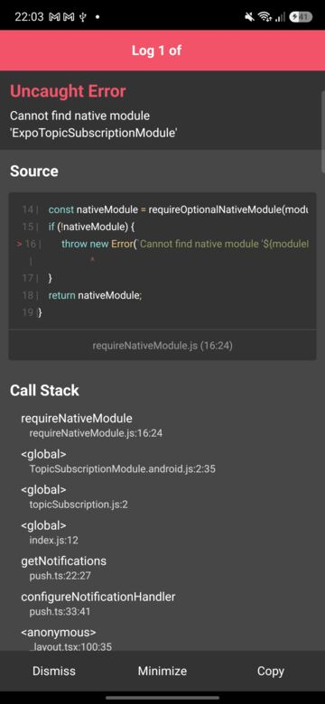
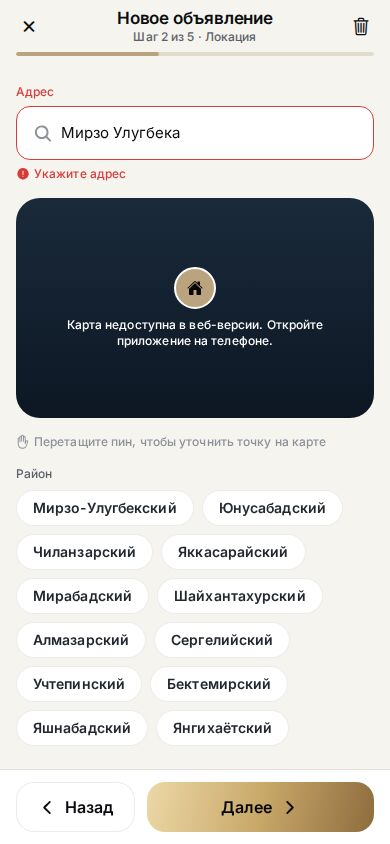

# SILKX — full app test, 22 Oct 2026

Issue #1. Tested commit `f08f3d6` on `adham/dev` (same as `main` at the time).

**Platforms:** Web (Chromium, 390×844 phone viewport, `npx expo start --web`) and Android
(Samsung Galaxy A16, Android 16, Expo Go 58.0.5). iOS was not tested (no device; Expo Go on iOS does not open SDK 58 yet).

**Method:** static checks, then scripted click-through of every screen as guest, buyer, developer and admin,
with console errors recorded on every step. Every bug below was reproduced at least twice.

## Summary

The core product works end to end on web: browsing, favorites, booking a viewing, chat with auto-reply,
the 5-step listing wizard, promotion + checkout, moderation, and user bans all behave correctly, and the UI is polished
in RU / UZ / EN and in dark mode.

Three bugs need fixing before the 31 October demo:

1. **Android / Expo Go: red error screen on every launch** (#A1). This is the setup the team uses for testing.
2. **The property screen can crash the whole app** after the user has opened the catalog filters (#A2). Affects all platforms.
3. **Web: a seller cannot get past the address step** of the listing wizard (#A3).

| ID | Severity | Platform | Problem |
|---|---|---|---|
| A1 | High | Android (Expo Go) | Launch shows "Cannot find native module 'ExpoTopicSubscriptionModule'" |
| A2 | High | All | Property screen crashes: "Cannot use 'in' operator to search for 'pages' in 23" |
| A3 | High (web) | Web | Address suggestions in the listing wizard cannot be selected |
| B1 | Medium | All | Home hero photo leaves an empty strip at the screen edge |
| B2 | Medium | All | "Cancel viewing" cancels immediately, no confirmation |
| B3 | Medium | Repo | No `package-lock.json`; `npm run lint` not set up |
| C1–C9 | Low | — | Smaller issues, see below |

---

## High

### A1. Android + Expo Go: error screen on every launch



**Steps:** open the app in Expo Go 58 on Android. A red "Uncaught Error — Cannot find native module
'ExpoTopicSubscriptionModule'" screen appears on every start. After *Dismiss* the app works.

**Cause:** [`src/lib/env.ts:27`](../../src/lib/env.ts) detects Expo Go with
`Constants.executionEnvironment === 'storeClient'`, but Expo Go 58 reports `"bare"` (checked on the device through the
JS debugger). So `isExpoGo` is `false`, and [`src/lib/push.ts:22`](../../src/lib/push.ts) loads `expo-notifications`,
whose push module does not exist in Expo Go on Android.

The `try/catch` around that `require` does not help: Metro reports module-initialisation errors straight to the
global fatal handler (`metro-runtime/src/polyfills/require.js:179-187`) instead of throwing them to the caller.
Because the require "fails", it is retried on every later call (`scheduleViewingReminder` when booking,
`ensurePushPermission` in Settings, `cancelScheduledReminder`), so the error screen is expected to reappear there too
(not verified on the device).

**Not affected:** real builds (APK / store). The native module is compiled in there.

**Fix (one line):** use Expo's official check, which returned `true` on the device:

```ts
import { isRunningInExpoGo } from 'expo';
// ...
isExpoGo: isRunningInExpoGo(),
```

### A2. Property screen crashes after the catalog filters were used


**Steps (web, 100% reproducible):**
1. Catalog → open *Filters* (no need to change anything).
2. Restart the app (on web: reload) and open any property that is not on the first page of the default
   catalog list, for example a rental: `/property/p25`. A push notification or a shared link does the same.
3. The whole app shows "Упс, что-то пошло не так" with the raw error text.

The control run without opening Filters does not crash.

**Cause:** [`src/hooks/api/catalog.ts:65-79`](../../src/hooks/api/catalog.ts) `findCachedProperty()` looks through every
cached query under `['properties']` for placeholder data and assumes each one is an array or paged data. The Filters
sheet caches `['properties', 'count', filters]`, which is a **number** (e.g. `23`), so `'pages' in 23` throws a
`TypeError`. The query cache is persisted, so after a restart the count query comes before the lists that would
otherwise have matched first. In-session navigation usually finds the property earlier and gets lucky.

**Fix:** skip anything that is not an object, or only look at list-shaped keys:

```ts
for (const [, data] of lists) {
  if (!data || typeof data !== 'object') continue;
  // ...
}
```

### A3. Web: listing wizard address step cannot be completed



**Steps:** Developer account → *Создать объявление* → fill step 1 → step 2, type "Навои" → click the suggestion
"ул. Навои". The suggestion disappears, the field keeps the typed text, and *Далее* shows "Укажите адрес".
There is no map on web to set the point instead, so the seller is stuck. Tested with mouse click, touch tap and a
raw pointer sequence; all three fail.

**Cause:** [`src/components/listing/WizardSteps.tsx:191-195`](../../src/components/listing/WizardSteps.tsx) renders the
suggestion list only while `focused`. On web, the input blurs on *mousedown*, `onBlur` sets `focused=false`,
the list unmounts, and the click lands on nothing. On native, `keyboardShouldPersistTaps="handled"` should prevent
this (not verified on the device).

**Fix:** keep the list mounted until a suggestion is chosen (for example, clear `focused` in a short `setTimeout` in
`onBlur`), or call `preventDefault()` on the suggestion's mousedown on web. With focus held during the click,
the rest of the wizard works (verified).

---

## Medium

### B1. Home hero photo leaves an empty strip at the edge

| Web | Android (4 frames, 5 s apart; the last one shows the gap) |
|---|---|
|  |  |

The background slowly zooms between 1.04× and 1.18× and pans ±26 px
([`src/components/home/AnimatedHero.tsx:47-51`](../../src/components/home/AnimatedHero.tsx), tokens in
`src/theme/tokens.ts:213-215`). At 1.04× the photo only overflows the screen by about 8 px per side, but the pan
(applied after the scale) moves it about 27 px, so a 16–19 px empty strip slides in on one side. The photo only covers
the full width once the zoom passes about 1.15×. This is the first screen of the demo.

**Fix:** limit the pan to the overflow, `|translateX| ≤ width·(scale − 1) / (2·scale)`, or raise `heroBaseZoom`
to about 1.17.

### B2. "Отменить показ" cancels without asking

[`src/app/viewings.tsx:92`](../../src/app/viewings.tsx) cancels immediately, with no confirmation and no undo.
One accidental tap removes a real booking. Sign-out already uses a confirmation sheet (`SignOutSheet`), so the same
pattern could be reused.

### B3. Reproducible installs and lint

- `package-lock.json` is not in the repo, so every `npm install` resolves fresh versions. This is risky for the
  demo APK build. Suggest committing the lockfile.
- `npm run lint` is not set up. On first run `expo lint` installs `eslint` and `eslint-config-expo` and creates
  `eslint.config.js`. Once set up, it reports **9 errors and 5 warnings**: React Compiler rules (`set-state-in-effect`
  in `catalog.tsx`, `seller/slots.tsx`, `useMarkerTracking.ts`, `BiometricGate.tsx`; `purity` in `profile.tsx`
  and `viewings.tsx`; `immutability` in `DonutChart.tsx`). These do not crash anything, but the compiler skips
  optimising those components.

---

## Low

- **C1. Web: card inside a button.** Property cards are `<button>`s and contain the heart `<button>`, which React reports
  as invalid HTML on every page (9 nested buttons on Home alone). In dev, Expo's red error toast for this sits on top
  of the *Каталог* / *Избранное* tabs and blocks taps on them
  ([screenshot](2026-10-22/web-dev-error-toast-over-tabbar.jpg)). Production users won't see the toast, but screen
  readers will still get the invalid nesting. `PropertyCard.tsx:61,142` + `FavoriteButton`.
- **C2. Wrong validation message.** In the wizard, an empty *Этаж* field says "Этаж не может быть выше этажности".
  One message key is used both for "empty" and for "higher than the floor count" (`src/features/listing/schemas.ts:18-21`).
- **C3. Chat header status.** After the seller replies, the header still says "был(а) Вчера, 17:32". "Вчера" should
  also be lowercase mid-sentence.
- **C4. AI description grammar.** "в Шайхантахурский районе" should be "в Шайхантахурском районе" (mock generator).
- **C5. Listing data is Russian in UZ/EN.** Addresses ("ул. Мирзо Улугбека, 56") and descriptions are not translated.
  The shared catalog database should have per-language fields.
- **C6. Uzbek search placeholder is cut off** in Catalog ("…boʻyicha qidi…").
- **C7. Seller slots** for today still allow toggling hours that have already passed (buyers can't book them anyway).
- **C8. Web console noise:** "Invalid DOM property `transform-origin`" on the property screen;
  "could not find scrollable ref!" when the Filters sheet opens.
- **C9. Demo credentials on the sign-in screen** ("Пароль для всех: Silkx2026!"). Fine for the demo, but they must be
  removed before a public release.

`npm audit` lists 22 "high" advisories, all in build tooling (`braces`, `node-forge`), not in app runtime code.

---

## What passed

**Static:** `npm run typecheck` 0 errors · `expo-doctor` 20/20 checks · RU/UZ/EN have the same keys (enforced by types),
no Russian strings left in `en.ts` / `uz.ts`.

**Guest:** all 14 public screens render, including not-found and missing-property states. Protected screens redirect
correctly: chats, viewings, booking and profile editing go to sign-in; seller and admin screens go to the profile;
`/manage` goes home.

**Buyer (21/21 steps):** demo sign-in · favorites add/remove · property page sections · mortgage calculator ·
book a viewing (date + slot + confirmation) · chat with seller, message sent and auto-reply received · chat list ·
my viewings · cancel viewing · notifications · edit profile (name saved) · sign out with confirmation.

**Developer (22/22 steps, using the A3 workaround):** dashboard stats and 7-day chart · wizard validation on every step ·
AI description · photo upload (blocked below 3, 3 accepted) · review screen · submit → "На модерации" ·
promote (VIP) → checkout (Payme) → receipt, VIP badge on the listing · viewing slots saved · seller chats ·
incoming viewing shows the buyer's name.

**Admin (13/13 steps):** tabs swap *Избранное* for *Управление* · approve (rental count 11 → 12, listing shows in
catalog) · reject with reason · user search · ban → banned buyer gets "Аккаунт заблокирован" at sign-in · unban ·
activity log.

**Other:** search (match, no results, clear) · sort · filters with live count, apply and reset · map view ·
wrong password · invalid email · sign-up validation, new account, duplicate email · dark theme ·
switching to Uzbek and English.

**Android (Expo Go):** app loads after dismissing A1, Home renders correctly in English and dark mode. Device testing
stopped there, so native-only behaviour (map, wizard address step, booking reminders) is still to check.
